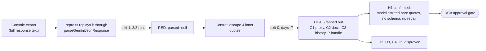

# Systematic Debugging Log: "Failed to generate 7-day plan" (unescaped quotes in Gemini JSON)

## 1. Issue Summary

- **Reported:** 2026-11-12 04:57 WIB, production `adaptiva.belajarcarabelajar.com`, bundle `index-CCeW8Zw3.js`. The UI shows "Oops! Something went wrong. Failed to generate 7-day plan." right after a new learning session starts.
- **Console chain:** `core.ts:188` "All JSON parsing attempts failed", then `curriculum.ts:334` "Failed to parse 7-day plan data", then `App.tsx:654` throws.
- **Evidence:** `~/Unduhan/console-export-2026-11-12_4-58-53.log`, lines 124-162. These lines hold the full response text.
- **Status:** RCA written, approval gate pending. On 2026-11-12 the owner asked in the same session to move AI calls to the Claude API instead (see section 4).

## 1b. Debugging Loop

## 1c. Phase 0: Feedback Loop

- **Command:** `bun ~/.cache/tmp/adaptiva-plan-json/repro.ts`. It replays `captured-response.json` (taken verbatim from log lines 124-162) through the real `apps/web/src/services/gemini/core.ts` `parseGeminiJsonResponse`.
- **Red:** exit 1 on 3 of 3 runs. Output: `JSON.parse: JSON Parse error: Expected '}'`, then `parsed=null days=0`.
- **Positive control:** the same text with only the four inner phrases escaped (`control-escaped.json`). Exit 0, `days=7`.

## 2. Phase 1: Deterministic Reproduction

- The load-bearing element is a literal `"` inside a JSON string value. The capture has four of them:
  - `"Pengantar Edutech"`
  - `"Analisis Kebutuhan"`
  - `"cara membuat kopi"`
  - `"Pengantar Teknologi Pendidikan"`
- The `\n` escapes in the same strings are intact. The console prints raw text, so the model did produce `\n` correctly and the bare quotes as shown.

## 3. Phase 2: Root Cause Analysis

| # | Hypothesis | Verdict | Evidence |
|---|---|---|---|
| H1 | In JSON mode without a schema, Gemini can emit a bare `"` inside a string, and the parser cannot repair it | **Confirmed** | Repro red and control green (above). `sanitizeJsonString` (`core.ts:111-127`) only strips trailing commas and escapes control characters. Its string regex `"(?:[^"\\]\|\\.)*"` stops at the first bare `"`, so attempts 1-5 all fail. On docs: Google's structured-output page (https://ai.google.dev/gemini-api/docs/structured-output, fetched 2026-11-12) ties "syntactically correct JSON" to a provided schema. Forum thread https://discuss.ai.google.dev/t/json-responses-and-plaintext-responses-with-json-doesnt-have-proper-double-quotations-escaping/33926 (2024-07-18, fetched 2026-11-12) reports the same bare-quote output in `application/json` mode. That is a user report, not a Google statement. |
| H2 | The proxy drops `responseMimeType` | Disproven | `functions/api/gemini/[[path]].ts:137-140` spreads `generationConfig` and only sets `maxOutputTokens`. |
| H3 | The proxy rewrites response text | Disproven (proxy); SDK not read | `[[path]].ts:473` and `:603-606` return `upstream.text()` byte-for-byte. |
| H4 | Regression from #50 (d478646) | Disproven | The pre-#50 loop and the pre-split `geminiService.ts` both return `null` on the capture. The scripts are in `~/.cache/tmp/adaptiva-plan-json/c3/`. |
| H5 | The deployed bundle differs from `main` | Disproven | The production `index-CCeW8Zw3.js` (HTTP 200, 1,018,987 B) contains the same parser strings: "All JSON parsing attempts failed" and "Default SpreadSheet Code". |

**Violated invariant:** every caller of `parseGeminiJsonResponse` assumes the model returns syntactically valid JSON. Nothing in the request enforces that assumption: all 7 callers send `responseMimeType: "application/json"` without `responseSchema`, and every model is `gemini-2.5-flash`. Nothing in the parser restores it either. Any free-text field that quotes a phrase therefore fails the whole generation.

**Same class (reported, not changed):**

| Caller | Generator |
|---|---|
| `curriculum.ts:105` | outline |
| `curriculum.ts:223` | module summary |
| `curriculum.ts:325` | 7-day plan (the reported failure) |
| `quiz.ts:76` | quiz |
| `quiz.ts:152` | quiz explanation |
| `quiz.ts:245` | exam |
| `flashcard.ts:72` | flashcards |

All of them are exposed to the same failure.

## 4. Phase 3: Fix options (none applied; needs the gate)

| Option | What | Fixes the class? | Cost |
|---|---|---|---|
| A | Claude API (`claude-sonnet-5-5`, effort `medium`) with structured outputs (`output_config.format` JSON schema) behind a Pages Function that holds `ANTHROPIC_API_KEY`. Requested by the owner 2026-11-12. | Yes. The schema constrains the output for every JSON caller. | Architectural. 9 call sites, chat streaming, `googleSearch` grounding in `resources.ts`, the proxy's points and refund logic, and the tests all change. |
| B | Keep Gemini and add `responseJsonSchema` per caller. The proxy forwards it unchanged (C1). | Yes, for the 7 callers. | Bounded. 7 schemas. |
| C | Quote repair in `sanitizeJsonString` | Heuristic only | Smallest change, but it can mis-repair. |

Was a Claude migration already planned? No record of one was found in the repo (`MEMORY.md`, `docs/`, git log) or in past session transcripts for this project. The owner's request in this session is the first record.

## 5. Phase 4: Regression Verification

Pending the gate.
