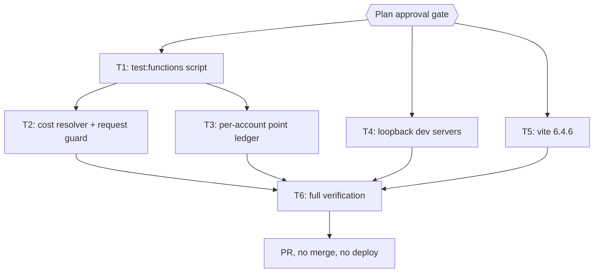
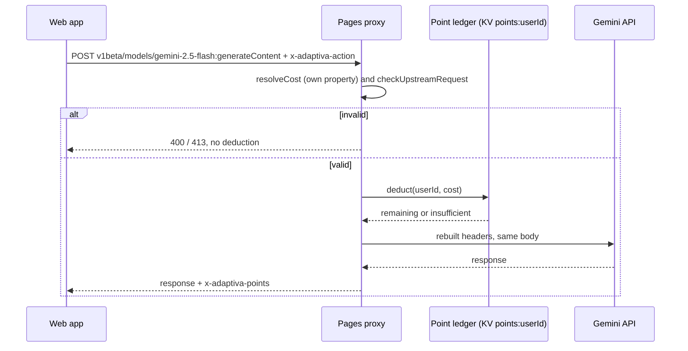

# adaptiva Gemini Proxy and Point Quota Hardening Plan (audit 2026-11-09, wave 1)

> Spec: `docs/code-plan/specs/2026-11-10-audit-gelombang-1-adaptiva-design.md`. The YAML frontmatter is the source of truth; when the checklist below disagrees with `run[]`, `run[]` wins. Commands run from the repository root; on this machine `SUCP_REMOTE_RUNNER='colab-test --'` executes them on the remote pool (AGENTS.md A47).

## Session checklist

- [x] Grounding: findings re-verified in code, owner decisions recorded (evidence: research report plus parent re-read of `_shared.ts:250-290` and `[[path]].ts:45-53,356-362`; baseline `colab-test -- bun test functions` exit 0, 90 pass; `git diff 78b250c origin/main -- functions apps/api apps/web/vite.config.ts` empty)
- [x] Plan validated: `bun scripts/ultra-plan-runner.mjs <plan>` exit 0, `Validation: OK` (one size WARN on generated `bun.lock`, see §3)
- [x] Plan published at Draft (`plan-sync.mjs`: publish exit 0, issue-sync exit 0, adaptiva#64), then approved (`Plan` gate, 2026-11-10)
- [x] T1 green: `bun run test:functions` exit 0 (RED exit 1 `Script not found`; GREEN exit 0, 90 pass, 0 fail; commit `623d771`)
- [x] T2 green: `bun test functions/api/gemini` exit 0 (RED exit 1, 15 of 18 fail; GREEN parent re-run exit 0, 30 pass incl. listen-host; commits `196724c`, `0cee873` mock isolation)
- [x] T3 green: `bun test functions/api/auth` exit 0 (RED exit 1, 10 behaviour cases fail against the old helpers; GREEN `bun run test:functions` exit 0, 127 pass, 0 fail; commit `fc2ffdb`)
- [x] T4 green: listen-host and devServer tests exit 0 (RED exit 1 each; GREEN exit 0, 3 pass and 1 pass; commit `847e855`)
- [x] T5 green: lockfile holds vite >= 6.4.6 (check exit 1 then 0 after `bun install --lockfile-only`; `bun run build` exit 0 printed vite v6.4.6; commit `3384994`)
- [ ] T6 green: functions, web tests, typecheck, build exit 0 (functions exit 0, 127 pass; web `bun run test` exit 0, 27 files; build exit 0; typecheck exit 1 with 196 errors identical to base `7699aa7` (diff of error lists empty), all in pre-existing test files: not met, see §6 and F5)
- [x] Review: parent diff audit plus documented self-review (no independent reviewer: subagent API limit, AGENTS.md A16); added evidence: fresh colab runs, base comparison of typecheck errors; findings resolved or in §8 (F4)
- [x] Deliver: commits on the session branch, PR #65 opened with `Refs #64` (`pr-registry open` exit 0), no merge, no deploy
- [ ] Sweep: session-close debt sweep and plan closeout

## 1. Intent & Scope

- **Goal:** close every verified critical and high finding of the 2026-11-09 audit in adaptiva (U1 per-session points, U2 header-chosen cost with prototype bypass, U3 open proxy, U4 non-atomic deduction plus `/me` rewrite, U5 dev proxy exposure, U6 Vite advisories).
- **Non-Goals:** medium and low findings, usage-based billing, rate limits, production deploy, changes to the web UI.
- **To-do list:** the checklist above is the only to-do list. The harness todo tool is not used.
- **Acceptance Criteria:**
  - [ ] AC-1: two sessions of the same `userId` share one balance; a new session does not get 100 fresh points.
  - [ ] AC-2: `x-adaptiva-action: constructor`, `__proto__`, `toString` and any unknown name get 400 and no deduction or upstream call.
  - [ ] AC-3: a non-POST method, another model, another endpoint, a query other than empty or `alt=sse`, or a body over 1 MB gets 4xx with no deduction and no upstream call; the upstream request carries no `cookie` header.
  - [ ] AC-4: `getSession` does not write KV when `refreshedAt` is younger than 24 hours and never writes the balance key; deduction and refund refuse a non-finite cost or balance.
  - [ ] AC-5: Express defaults to `127.0.0.1` and the Vite config has no `server.host`.
  - [ ] AC-6: `bun.lock` resolves vite 6.4.6 or later in the 6.4 line.
  - [ ] AC-7: functions tests, web tests, web typecheck and build all exit 0.
- **Traceability:** one row per AC.

| AC | Task | Check | Evidence |
|---|---|---|---|
| AC-1 | T3 | `bun test functions/api/auth/__tests__/points.test.ts` | two-session test passes |
| AC-2 | T2 | `bun test functions/api/gemini/__tests__/request-guard.test.ts` | prototype-name cases pass |
| AC-3 | T2 | `bun test functions/api/gemini/__tests__/request-guard.test.ts` | method, model, query, size, cookie cases pass |
| AC-4 | T3 | `bun test functions/api/auth` | no-rewrite and NaN cases pass |
| AC-5 | T4 | `bun test apps/api/src/listen-host.test.js` | default host test passes |
| AC-6 | T5 | the `bun -e` lockfile check in T5 | exit 0 |
| AC-7 | T6 | the four T6 commands | each exit 0 |

## 2. Visual Implementation Map

## 2b. Affected Surfaces

| Task | Affected surface | Relationship | Evidence | Action taken in this plan |
|---|---|---|---|---|
| T1 | `scripts/deploy-website.sh` test step | runs only the web suite | `rg -n 'test' scripts/deploy-website.sh` | unchanged; noted in backlog F3 |
| T2 | `apps/web/src/services/pointCosts.test.ts` | imports `ACTION_POINT_COSTS` | `rg -n 'ACTION_POINT_COSTS' apps/web/src` | export kept with the same shape |
| T2 | frontend Gemini calls | must match the allowlist | `rg -n 'getAiClient' apps/web/src/services/gemini` | all use `gemini-2.5-flash` via the SDK; verified in T2 tests with the SDK path shape |
| T2 | `[[path]].test.ts` | uses `gemini-1.5-flash` and `?key=value` | `rg -n 'gemini-1.5-flash' functions` | fixtures updated to the allowed shape |
| T3 | Gemini proxy | calls `deductUserPoints`/`refundUserPoints` | `rg -n 'deductUserPoints' functions` | signatures unchanged |
| T3 | `/api/auth/me` consumers | read `user.points` | `rg -n 'points' apps/web/src/services` | shape unchanged |
| T4 | `README.md` dev section | documents ports | `rg -n '3000\|3001' README.md` | updated if it claims LAN access |
| T5 | vitest 5 | peer range on vite | `bun pm view vitest@5.0.0 peerDependencies` | checked before the bump |

- [ ] Every task appears above.
- [ ] Every out-of-scope surface a subagent reports becomes a task here or a `defer:` line in §8.
- [ ] Docs that describe the changed behaviour are in this table.

## 3. Global Constraints

- No new runtime dependency. Bun only (`bun test`, `bun run`, `bun install`).
- Heavy commands go through `colab-test` (AGENTS.md A47); `bun install --lockfile-only` runs locally because it writes the lockfile here.
- No production deploy, no KV writes against production, no secrets printed.
- Exported names `ACTION_POINT_COSTS`, `deductUserPoints`, `refundUserPoints`, `getSession`, `createSession` keep their signatures.
- `bun.lock` (T5) is a generated lockfile above the 20,000-byte size warning; it is not split, and this repository has no size gate (`rg -n 'size' package.json` is empty).
- Body limit: 1 MB (assumption: the web app sends text only, no `inlineData`; `rg -n 'inlineData' apps/web/src` is empty).

## 4. Work Breakdown & Task Checklist

### Task T1: functions test script

- **Interfaces:** Produces the root script `test:functions` = `bun test functions`.
- **Preconditions:** `bun --version` exits 0 (else `E_PRECOND_DEP`).
- **Idempotency Check:** skip when `bun run test:functions` exits 0.
- [ ] **Step 1 (RED):** `bun run test:functions` | expect exit 1 (script missing) | retry 0
- [ ] **Step 2 (GREEN):** add `"test:functions": "bun test functions"` to the root `package.json` scripts.
- [ ] **Step 3 (Verify):** `bun run test:functions` | expect exit 0 (baseline 90 pass) | retry 1
- [ ] **Step 4 (Commit):** `git add package.json` then `git commit -m "test: add test:functions script for Pages Functions"`

### Task T2: cost resolver and request guard in the Gemini proxy

- **Interfaces:**
  - Consumes: `deductUserPoints(request, env, cost)` and `refundUserPoints(request, env, amount)` (unchanged).
  - Produces: `resolveCost(action: string): number | null` (own-property lookup on `ACTION_POINT_COSTS`, `null` for unknown); `checkUpstreamRequest(request, params): { ok: true } | { ok: false, status: 400 | 405 | 413, error: string }`; `buildUpstreamHeaders` returning only `content-type`, `x-goog-api-key`, and `x-goog-api-client` when present.
- **Preconditions:** T1 done (`bun run test:functions` exits 0, else `E_PRECOND_UPSTREAM`).
- **Rules:** method `POST` only; path must match `^v1beta/models/gemini-2\.5-flash:(generateContent|streamGenerateContent)$`; query empty or exactly `alt=sse`; body over 1,048,576 bytes gets 413 (check `content-length` first, then the buffered length); all checks run before `processPointDeduction`; the catch-block refund uses `resolveCost` and refunds nothing for an unknown action; CORS `Access-Control-Allow-Methods: POST, OPTIONS`.
- [ ] **Step 1 (RED):** write `functions/api/gemini/__tests__/request-guard.test.ts` with cases: `constructor`, `__proto__`, `toString`, `nope` → 400 and the deduct mock not called; `GET` → 405; `gemini-2.5-pro:generateContent` → 400; `v1beta/files` → 400; `?key=x` → 400; `?alt=sse` streaming path → forwarded; 1 MB + 1 body → 413; a request with `cookie: adaptiva_sess=x` reaches `fetch` without a `cookie` header. Run `bun test functions/api/gemini/__tests__/request-guard.test.ts` | expect exit 1 | retry 0
- [ ] **Step 2 (GREEN):** implement the rules in `[[path]].ts`; update the fixtures in `[[path]].test.ts` from `gemini-1.5-flash` with `?key=value` to `gemini-2.5-flash:generateContent` with no query.
- [ ] **Step 3 (Verify):** `bun test functions/api/gemini` | expect exit 0 | retry 1
- [ ] **Step 4 (Commit):** `git add "functions/api/gemini/[[path]].ts" "functions/api/gemini/__tests__/[[path]].test.ts" functions/api/gemini/__tests__/request-guard.test.ts` then `git commit -m "fix(gemini): validate action cost and restrict proxied requests"`

### Task T3: per-account point ledger

- **Interfaces:**
  - Produces in `functions/api/auth/points.ts`: `pointsKey(userId: string): string` (`points:<userId>`); `getBalance(env, userId): Promise<number>` (seeds `DEFAULT_INITIAL_POINTS` once when the key is missing); `deductPoints(env, userId, cost): Promise<{ success: boolean; remainingPoints: number }>`; `refundPoints(env, userId, amount): Promise<{ success: boolean; remainingPoints: number }>`. A cost or amount that is not a finite positive number, or a stored value that is not a finite number, returns `success: false` without writing.
  - `deductUserPoints` and `refundUserPoints` in `_shared.ts` keep their signatures and return shapes, resolve `sess:<sid>` to `session.userId`, and delegate to the ledger. `createSession` stops writing `points` and writes `refreshedAt`. `getSession` writes the session back only when `refreshedAt` is missing or older than 24 hours, and never touches `points:*`.
  - `me.ts` returns `points: await getBalance(env, session.userId)`.
- **Preconditions:** T1 done (else `E_PRECOND_UPSTREAM`).
- [ ] **Step 1 (RED):** write `functions/api/auth/__tests__/points.test.ts` over a `Map`-backed fake KV: two sessions with the same `userId` share one balance (spend 100 on the first, the second sees 0); seed happens once; `deductPoints(env, id, Object as any)` and `deductPoints(env, id, NaN)` return `success:false` without a write; a stored `"null"` balance refuses to deduct; refund adds back; `getSession` on a fresh `refreshedAt` performs no `put`. Run `bun test functions/api/auth/__tests__/points.test.ts` | expect exit 1 | retry 0
- [ ] **Step 2 (GREEN):** add `points.ts`; change `_shared.ts` and `me.ts`; update the existing auth tests that assume the balance lives in the session.
- [ ] **Step 3 (Verify):** `bun test functions/api/auth` | expect exit 0 | retry 1
- [ ] **Step 4 (Commit):** `git add functions/api/auth/points.ts functions/api/auth/__tests__/points.test.ts functions/api/auth/_shared.ts functions/api/auth/me.ts functions/api/auth/_shared.test.ts functions/api/auth/__tests__/_shared.test.ts functions/api/auth/__tests__/me.test.ts` then `git commit -m "fix(auth): keep the point balance per account instead of per session"`

### Task T4: loopback dev servers

- **Interfaces:** Produces `resolveListenHost(env: Record<string, string | undefined>): string` in `apps/api/src/listen-host.js` (returns `env.HOST` when non-empty, else `127.0.0.1`); `server.js` calls `app.listen(port, resolveListenHost(process.env))`; `apps/web/vite.config.ts` drops `host: '0.0.0.0'`.
- [ ] **Step 1 (RED):** write `apps/api/src/listen-host.test.js` (default `127.0.0.1`, blank `HOST` → `127.0.0.1`, `HOST=0.0.0.0` honoured) and `apps/web/src/devServer.test.ts` (imports `../vite.config` and asserts `server.host` is undefined or a loopback address). Run `bun test apps/api/src/listen-host.test.js` | expect exit 1 | retry 0
- [ ] **Step 2 (GREEN):** add `listen-host.js`, wire it into `server.js`, edit `vite.config.ts`; adjust the README dev section if it promises LAN access.
- [ ] **Step 3 (Verify):** `bun test apps/api/src/listen-host.test.js` exit 0, then `bun run --cwd apps/web test src/devServer.test.ts` exit 0 | retry 1
- [ ] **Step 4 (Commit):** `git add apps/api/src/listen-host.js apps/api/src/listen-host.test.js apps/api/src/server.js apps/web/vite.config.ts apps/web/src/devServer.test.ts` then `git commit -m "fix(dev): bind Express and Vite dev servers to loopback"`

### Task T5: Vite 6.4.6

- **Preconditions:** `bun pm view vitest@5.0.0 peerDependencies` includes a vite range that admits 6.4.6 (else `E_PRECOND_DEP`, record in §6, stop this task only).
- [ ] **Step 1 (RED):** the `bun -e` lockfile check | expect exit 1 (lock holds 6.4.3) | retry 0
- [ ] **Step 2 (GREEN):** set `"vite": "^6.4.6"` in `apps/web/package.json`, then `bun install --lockfile-only` (local, writes `bun.lock` only) | expect exit 0 | retry 1
- [ ] **Step 3 (Verify):** the `bun -e` lockfile check | expect exit 0 | retry 0
- [ ] **Step 4 (Commit):** `git add apps/web/package.json bun.lock` then `git commit -m "chore(deps): bump vite to 6.4.6 for dev server advisories"`

### Task T6: full verification

- [ ] `bun run test:functions` exit 0
- [ ] `bun run test` exit 0
- [ ] `bun x tsc --noEmit --project apps/web/tsconfig.json` exit 0
- [ ] `bun run build` exit 0

## 5. Verification Matrix Before Completion

| Check | Command | Exit Code | Fresh Evidence | Status |
|---|---|---|---|---|
| Functions tests | `bun run test:functions` | 0 | 0 failures | Pending |
| Web tests | `bun run test` | 0 | 0 failures | Pending |
| Type Check | `bun x tsc --noEmit --project apps/web/tsconfig.json` | 0 | 0 errors | Pending |
| Lint Check | none configured in this repo | n/a | n/a | n/a |
| Build Check | `bun run build` | 0 | build succeeded | Pending |

## 6. Error Ledger

| Task | Step | Classification | Exit | Expected | Transient | Root cause | Evidence (log tail) | Retry used | Status |
|---|---|---|---|---|---|---|---|---|---|
| T6 | 3 | environment | 1 | 0 | false | pre-existing: 196 TS errors in existing test files (`toBeInTheDocument` and similar jest-dom matchers untyped); identical list on base `7699aa7` | `apps/web/src/components/TopicInputForm.test.tsx(82,47): error TS2339` | 0/1 | `DEFERRED` |
| T2 | review | code | n/a | n/a | false | `request-guard.test.ts` lacked `mock.restore()`, so the mocked auth module leaked into later auth test files (11 failures in the full run) | `deductUserPoints > should return failure if sid cookie is missing` received success true, 95 | 0/0 | `RESOLVED` |

## 7. Human Approval Gate

- [x] Partner / Human approval received for this plan before implementation begins.

| Gate | Answer | Date |
|---|---|---|
| `Intent` | Locked (wave 1, kritis + tinggi, no deploy) | 2026-11-10 |
| `Section adaptiva` | Approved | 2026-11-10 |
| `Spec` | Approved | 2026-11-10 |
| `Plan` | Approved (all three plans, subagent execution, PR only, no merge or deploy) | 2026-11-10 |

Assumptions recorded: quota key = Google `sub` with the existing email fallback; body limit 1 MB; KV race accepted; existing accounts start at 100.

## 8. Session-Close Debt Sweep & Follow-Up Backlog

| # | Follow-up (outcome + path + finish line) | Class | `defer: <ceiling>, <upgrade-trigger>` | Status |
|---|---|---|---|---|
| F1 | Charge by `usageMetadata` so a client cannot claim the cheaper `tutor` price | `LATER` | `defer: owner decision on billing model, next abuse signal in Gemini usage` | `OPEN` |
| F2 | Medium and low findings of the 2026-11-09 audit (`temuan-adaptiva.json`, `l2-adaptiva.json`) | `LATER` | `defer: wave 3 sweep, owner schedules it` | `OPEN` |
| F3 | Run `test:functions` inside `scripts/deploy-website.sh` before deploy | `LATER` | `defer: next deploy-script change, or first function regression` | `OPEN` |
| F4 | `onRequest` catch block refunds even when no deduction happened (for example a KV error inside `deductUserPoints`); record whether the deduction ran | `NOW` | | `OPEN` |
| F5 | Web typecheck red on `main` (196 errors, untyped jest-dom matchers in existing tests); fix the test typing in its own PR so T6 can pass | `NOW` | | `OPEN` |
| F6 | Express dev proxy (`apps/api`) still injects the key without auth when someone sets `HOST=0.0.0.0` | `LATER` | `defer: apps/api is dev-only, next dev-tooling change` | `OPEN` |

- [ ] 3-5 ranked follow-ups injected as one question-tool call of multi-select checkboxes after the final recap.
- [ ] Every selected follow-up executed through the full pipeline with fresh evidence.
- [ ] Declined and out-of-cap items written here so no debt leaves the session unrecorded.
