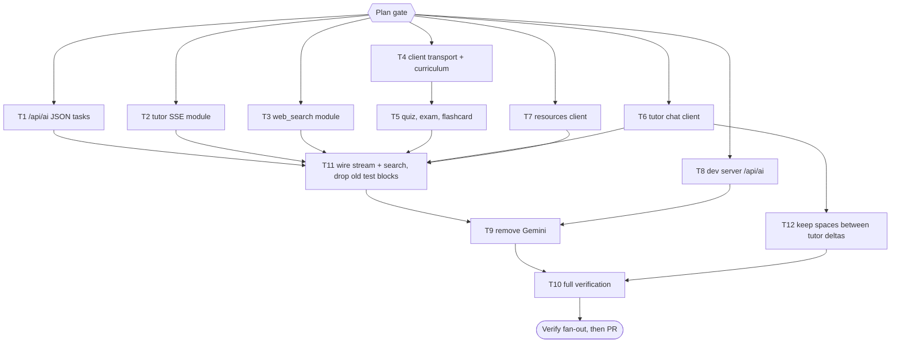

# Migrating Adaptiva AI to the Claude API: Implementation Plan

> For agentic workers: REQUIRED EXECUTION METHOD: delegated task execution, with the parent owning git. Steps use checkbox syntax.

**Goal:** every AI feature runs on Claude (Sonnet 5.5 or Haiku 5.5, per task) through `/api/ai`, and every JSON output is constrained by a server-side schema.
**Architecture:** a Pages Function `functions/api/ai` that holds the task registry, the points core and the SDK gateway. The web services keep their exported names and call `callAiTask`. The `apps/api` dev server runs the same core without points.
**Tech Stack:** Bun 1.4.4, Cloudflare Pages Functions (`nodejs_compat`), `@anthropic-ai/sdk` 1.3.0, React 19 with Vite and vitest, Express dev server.
**Active Project Profile:** repo `/home/belajarcarabelajar/Proyek/adaptiva`. Plan written at `f9d4e91`. Execution base is `origin/main` `1015764`: #71 makes Vite proxy all of `/api` to `apps/api` and adds `/api/auth/me` 401, so T8 only needs the `/api/ai` route in `apps/api`., bun workspaces `apps/*` and `packages/*`; config in `package.json`, `apps/web/package.json`, `wrangler.jsonc`, `tsconfig.base.json` and `apps/web/tsconfig.json`.
**Project Commands:** web `bun run --cwd apps/web test <path>`, functions `bun run test:functions` (`--isolate`, MEMORY.md), dev API `bun test apps/api/src`, typecheck `bun x tsc --noEmit --project apps/web/tsconfig.json`, build `bun run build`. Heavy commands go through `colab-test` (A47).
**Protected Boundaries:**
- Point costs and refund semantics.
- The error strings matched in `core.ts` `callWithRetries`.
- `functions/api/auth/*`.
- The `adaptiva_sess` session cookie.
- The `GEMINI_API_KEY` secret is not deleted.
- No deploy.
**Spec:** `docs/code-plan/specs/2026-11-12-migrasi-claude-design.md`
**RCA:** `docs/code-plan/debug/2026-11-12-plan-7-hari-json-kutip-rca.md`
**Scope:** the 9 call sites, the new `/api/ai` function, the dev server, and removal of Gemini.
**Non-Goals:**
- Changing point prices.
- Production deploy (asked after the PR).
- Deleting the `GEMINI_API_KEY` secret.
- Renaming `services/gemini/` (`defer: names stay "gemini", upgrade-trigger: next bulk PR in services/`).
- The per-chunk trim in the tutor (old behaviour).

## Session checklist

- [x] Feedback loop for the original bug: `bun ~/.cache/tmp/adaptiva-plan-json/repro.ts` exit 1 on 3/3 runs; control exit 0, days=7.
- [x] Hypothesis chunks C1-C3 gathered, plus the parent bundle check. H1 confirmed; H2-H5 disproven (RCA file).
- [x] RCA written: `docs/code-plan/debug/2026-11-12-plan-7-hari-json-kutip-rca.md`.
- [x] Owner decisions, question tool 2026-11-12:
  - Scope: migrate everything.
  - Points: per-action model mapping, costs unchanged.
  - Intent: mapping approved.
- [x] `ANTHROPIC_API_KEY` installed by the owner. `wrangler pages secret list --project-name adaptiva` lists it in production.
- [x] Research R1 (call sites and schemas), R2 (proxy contract), R3 (SDK shapes) gathered. The spec cites them.
- [x] Plan validated: `bun ~/vivera/scripts/ultra-plan-runner.mjs <plan>` exit 0, `Validation: OK`. Published: `plan-sync` publish exit 0, issue-sync exit 0 -> #72. `Plan` gate approved by the owner 2026-11-12.
- [x] Session claimed. `pr-registry claim --session migrasi-claude-adaptiva --repo <adaptiva> --worktree` reports claimed, with worktree `/mnt/belajarcarabelajar/adaptiva-wt/migrasi-claude-adaptiva` on branch `2026-11-12-migrasi-claude/migrasi-claude-adaptiva` from `origin/main` 1015764. The first claim omitted `--repo` and landed in vivera: its clean worktree and branch were removed, and its slot was set to `closed`.
- [x] T1-T10 done with evidence, per the tasks below. Evidence: `ultra-plan-runner --execute` exit 0 (T1-T9, T11, T12 SKIPPED-IDEMPOTENT, T10 PASSED), 2026-11-12.
- [x] Fix verification fan-out: replay the original repro, regression suites, sibling-caller audit, and an 8-criteria diff review. Evidence: T10 suites exit 0 (functions 215 pass, web 365, api 22, both typechecks, build, wrangler functions build); independent review round 2 verdict correct after two fixes (5019104, 62e57f6); sibling callers checked by the reviewer.
- [x] Deliver: commit on the session branch, PR with `Refs #<n>`, plan and issue re-synced. Evidence: PR #73 (`Refs #72`), `plan-sync` publish exit 0, issue-sync exit 0.
- [x] Debt sweep, learning ledger, `graphify update` and `graphify:sync`. Evidence: the sweep is recorded in Follow-up backlog, the ledger file is committed, and `graphify update .` exit 0 plus sync (nodes 670 -> 713, CURRENT) ran in the main checkout. They run again after the merge.

## Visual Map

**Reasoning Lenses:**
- Investigative: RCA H1-H5.
- Computational: the schema guarantees 7 days.
- Security: the server picks model and schema; the key lives only in the Function.
- Compatibility: exported names and the error strings stay.
- Operational: rollback by revert while the Gemini secret is still present.
- Test-first: each task opens with a RED run.

**Acceptance Criteria:**
- [x] AC-1: `curriculum.sevenDayPlan` goes to `claude-sonnet-5-5`, effort `medium`, with a JSON schema whose required properties are `day1`..`day7`. Evidence: `_tasks.ts:76-86`, `tasks.test.ts`.
- [x] AC-2: every JSON task sends the registry's model, effort, `max_tokens` and schema, and nothing from the client overrides them. Evidence: `tasks.test.ts`, `core.test.ts`.
- [x] AC-3: the points and error contract: deduct before the call, one refund on API or network error, `x-adaptiva-points`, and the five error strings. Evidence: `core.test.ts`, `core-followups.test.ts`, `index.test.ts`.
- [x] AC-4: the tutor streams SSE from `claude-haiku-5-5` with the client-supplied history. Evidence: `tutor.test.ts`, `core-routes.test.ts`, `chat.test.ts`.
- [x] AC-5: resources use `web_search_20250305` on Sonnet 5.5 and return `{text, sources}`. Evidence: `_search.ts:58`, `search.test.ts`, `resources.test.ts`.
- [x] AC-6: the exported web service names and parameters are unchanged; callers behave the same. Evidence: web suite exit 0 (365 tests), web tsc exit 0.
- [x] AC-7: Gemini is gone, and the suites, typecheck and build exit 0. Evidence: T9 probe exit 0; suites, typechecks and build exit 0.

**Traceability:**

| AC | Task | Check | Evidence |
|---|---|---|---|
| AC-1 | T1, T4 | `bun test --isolate functions/api/ai/__tests__/tasks.test.ts` and `bun run --cwd apps/web test src/services/gemini/curriculum.test.ts` | the sevenDayPlan schema is `day1..day7` required; the client maps it to 7 days |
| AC-2 | T1 | `bun test --isolate functions/api/ai/__tests__/claude.test.ts` | request body from the gateway: model, effort, format, betas/fallbacks only on Sonnet |
| AC-3 | T1 | `bun test --isolate functions/api/ai/__tests__/core.test.ts` | the status, error and refund table from spec 2.3 |
| AC-4 | T2, T6, T11 | `bun test --isolate functions/api/ai/__tests__/tutor-stream.test.ts` and `bun run --cwd apps/web test src/services/gemini/chat.test.ts` | SSE frames delta, done and error; history appended |
| AC-5 | T3, T7, T11 | `bun test --isolate functions/api/ai/__tests__/resources.test.ts` and `bun run --cwd apps/web test src/services/gemini/resources.test.ts` | sources de-duplicated from `web_search_tool_result`, `pause_turn` at most 2 |
| AC-6 | T4, T5, T6, T7 | `bun x tsc --noEmit --project apps/web/tsconfig.json` | exit 0 with no change to the call sites in App.tsx and the hooks, except the `Chat` type |
| AC-7 | T9, T10 | `bun run test`, `bun run test:functions`, `bun test apps/api/src`, `bun run build` | all exit 0; `rg` for google/genai and api/gemini outside `*.test.*` is empty (two tests assert the removal) |

**Assumptions & Open Questions:**
- An effort of `medium` on Sonnet 5.5 follows the owner's request, even though the docs suggest `low` for content generation.
- Refusals are not refunded, following the old proxy's blocked handling.
- `web_search_20250305` instead of `20260209` (spec section 3).

**Dependencies & Impact:**
- New: `@anthropic-ai/sdk` 1.3.0 at the root, where Functions resolve modules.
- Removed: `@google/genai` from `apps/web`.
- Consumers: `App.tsx`, `hooks/useFlashcards.ts`, `pointCosts.test.ts`, `devServer.test.ts`, `apps/api`.

**Risks & Rollback:** cost (Sonnet plus search with the same points), refusal categories without fallback, and SDK bundle size on Workers (measured in T10). Rollback: `git revert` the merge; `GEMINI_API_KEY` is still in Pages.
**Security & Compatibility:**
- The key exists only in the Function and in the dev server's `.env.local`.
- The dev server stays loopback only.
- The client sends no model, schema or `max_tokens`.
- The `messages` sent to the tutor are validated: roles, at most 40 turns, at most 8,000 characters each.
**Operations & Rollout:** no deploy in this plan. After merge, the owner chooses to deploy; the post-deploy check is a new session plus a 7-day plan in production.
**CI/Review Gate:** repo hooks; the verification fan-out after T10; an independent reviewer (`staid`).
**Documentation:** README (env and dev), `.env.example`, `wrangler.jsonc` comment, MEMORY.md lessons in the debt sweep.
**Definition of Done:** AC-1 to AC-7 checked with exit codes, the PR opened with `Refs #<n>`, and the debt sweep done.
**Reproducibility:** Bun 1.4.4. The Anthropic tests use a fake gateway or a fake `fetch`, so there is no network and no key in the tests.
**Test Reliability:** functions tests always run with `--isolate` (MEMORY.md). There is no real time or network in the tests.
**Privacy & Data Governance:** prompts carry learning topics and chat; no personal data is added. The key is never logged.
**Dependencies & Supply Chain:** `@anthropic-ai/sdk` is the official package from Anthropic; `bun.lock` is updated in T1.
**UX States:** the error messages stay in Indonesian as before, and the tutor's apology on stream failure stays.
**Persistent State & Artifact Storage:** `HistoryItem.learningResources` keeps its shape. `TutorSession.chat` changes type; it is recreated on load, as before.
**Entity & Sourcing Verification:** spec section 6 (docs fetched 2026-11-12).
**Verification:** T10 plus the verification fan-out.

## Global Constraints

- The model, effort, `max_tokens` and schema come only from `functions/api/ai/_tasks.ts`.
- Every schema: object root, `additionalProperties: false`, all properties required, no `maxItems` and no `minItems > 1`.
- No `temperature`, `top_p`, `top_k`, `thinking: disabled` or `budget_tokens`. `fallbacks` only on Sonnet.
- The error strings, refund notes and points come verbatim from `functions/api/gemini/[[path]].ts` (spec 2.3).
- Subagents never touch git; the parent stages by path.

## Tasks

### Task T1: /api/ai endpoint for JSON tasks

**Files:**
- Create:
  - `functions/api/ai/_tasks.ts`: the registry plus `ACTION_POINT_COSTS` and `resolveTask`.
  - `functions/api/ai/_claude.ts`: `createClaudeGateway`.
  - `functions/api/ai/_core.ts`: `handleAiRequest`.
  - `functions/api/ai/index.ts`: `onRequest`, with real deps and CORS copied from the old proxy.
  - Tests: `__tests__/tasks.test.ts`, `claude.test.ts`, `core.test.ts`.
- Modify: `package.json` and `bun.lock`, to add `@anthropic-ai/sdk`.

**Interfaces:**
- Produces:
  - `type TaskId`.
  - `resolveTask(id): TaskSpec | null`.
  - `ACTION_POINT_COSTS`.
  - `createClaudeGateway(apiKey, fetchImpl?)`.
  - `handleAiRequest(request, env, deps)`.
  - Response `{text}`.

**Steps:**
- [x] Write `tasks.test.ts`. It asserts:
  - the 7-row mapping (model, effort, `max_tokens`, action);
  - that the sevenDayPlan schema requires `day1`..`day7`;
  - that no schema uses `maxItems` or `minItems > 1`.
- [x] Write `claude.test.ts` with a fake `fetch` that returns an SSE message:
  - the request body has `output_config.{effort, format}`;
  - Sonnet sends the `anthropic-beta: server-side-fallback-2026-07-01` header plus `fallbacks: "default"`; Haiku sends neither;
  - text is read from the `text` block after `thinking`.
- [x] Write `core.test.ts` with a fake gateway and fake deduct and refund, covering each row of spec 2.3.
- [x] Run `bun test --isolate functions/api/ai`: expect exit 1 (RED).
- [x] Implement, then run it again: exit 0.

**Edge cases:**
- Unknown task.
- `prompt` empty or not a string.
- Body over 1 MiB.
- A refund that throws.
- `max_tokens` stop.
- Refusal.

**Deliberate Shortcuts:** None.

### Task T2: tutor SSE

**Files:**
- Create: `functions/api/ai/__tests__/tutor-stream.test.ts`.
- Modify: `_core.ts` (the `tutor.chat` branch) and `_claude.ts` (`streamText`).

**Behavior:**
- Frames are `delta`, `done` and `error`.
- An error before the first delta gets a refund; an error after partial output does not.
- `messages` is validated: roles, a final `user` turn, at most 40 turns, at most 8,000 characters each.

**Steps:** RED with `bun test --isolate functions/api/ai/__tests__/tutor-stream.test.ts` (exit 1), implement, then GREEN with `bun test --isolate functions/api/ai` (exit 0).

### Task T3: resources with web_search

**Files:**
- Create: `functions/api/ai/__tests__/resources.test.ts`.
- Modify: `_core.ts`, `_claude.ts` and `_tasks.ts` (the `resources.search` row).

**Behavior:**
- The tool is `{type: "web_search_20250305", name: "web_search", max_uses: 3}`.
- `sources` are unique `{uri, title}` pairs taken from `web_search_tool_result`.
- On `pause_turn` the request continues at most 2 times.
- A search error inside a 200 response gives `sources: []`.

**Steps:** RED (exit 1), implement, then GREEN with `bun test --isolate functions/api/ai` (exit 0).

### Task T4: client transport and curriculum (the reported bug)

**Files:**
- Create: `apps/web/src/services/gemini/aiClient.test.ts` and `curriculum.test.ts`.
- Modify:
  - `core.ts`: `callAiTask` replaces `getAiClient` and `ai`.
  - `curriculum.ts`: the three generators; the 7-day prompt becomes `day1..day7`, and the mapping goes back to `days[]`.
  - `constants.ts`: remove the Gemini model constants.
  - `core.gap.test.ts`: the `getAiClient` block becomes `callAiTask`.
  - `geminiService.test.ts`: remove the curriculum blocks.

**Regression test (correct seam):**
- `curriculum.test.ts` feeds `{day1..day7}` through a fake `fetch`, with text values that contain `"quoted phrases"` (valid JSON, escaped).
- `generateSevenDayPlan` must return 7 days, in order, with the right `day` values.
- The request must have `task: "curriculum.sevenDayPlan"` and must not carry a model.

**Steps:**
- [x] RED: `bun run --cwd apps/web test src/services/gemini/curriculum.test.ts`, expect exit 1.
- [x] Implement.
- [x] GREEN: `bun run --cwd apps/web test src/services`, expect exit 0.

### Task T5: quiz, exam and flashcard

**Files:**
- Create: `quiz.test.ts` and `flashcard.test.ts`.
- Modify:
  - `quiz.ts`: wrap the quiz as `{questions}`; drop `type` and `maxPoints` from the exam prompt.
  - `flashcard.ts`.
  - `geminiService.test.ts`.

**Steps:** RED (exit 1), implement, then GREEN with `bun run --cwd apps/web test src/services src/hooks` (exit 0). The `useFlashcards` tests mock the barrel, so they stay valid.

### Task T6: tutor chat client

**Files:**
- Create: `chat.test.ts`.
- Modify:
  - `chat.ts`: `TutorChat` and the SSE reader.
  - `types.ts`: `TutorSession.chat: TutorChat | null`.
  - `App.tsx`: the `Chat` import becomes `TutorChat`.
  - `geminiService.test.ts`.

**Behavior:**
- `startChatSession` is synchronous and keeps all three system-instruction variants.
- The history gains the user turn and the assistant turn after `done`.
- On an error frame or a network failure, the apology is sent through `onChunk`, as before.

**Steps:** RED (exit 1), implement, GREEN for `src/services` (exit 0), then `tsc` (exit 0).

### Task T7: resources client

**Files:**
- Create: `resources.test.ts`.
- Modify: `resources.ts` (one call to `resources.search`; the retry without tools is removed, because the server has no Google grounding to fail over from) and `geminiService.test.ts`.

**Behavior:**
- `{text, sources}` maps to `{content, sources: [{web: {uri, title}}]}`.
- Empty text returns `null`.

**Steps:** RED (exit 1), implement, then GREEN (exit 0).

### Task T8: dev server /api/ai

**Files:**
- Modify:
  - `apps/api/src/app.js`: POST `/api/ai` calls `handleAiRequest` with no-op points; remove the `/api/gemini` proxy.
  - `env.js`: `requireAnthropicKey`.
  - `server.js`.
  - Tests in `app.test.js` and `env.test.js`.
  - `apps/web/vite.config.ts`: proxy `/api/ai`.
  - `apps/web/src/devServer.test.ts`.

**Steps:** RED `bun test apps/api/src/app.test.js` (exit 1), implement, then GREEN `bun test apps/api/src` (exit 0) and `devServer.test.ts` (exit 0).

### Task T9: remove Gemini

**Files:**
- Delete `functions/api/gemini/` along with its tests. Their behaviour is now covered by T1-T3.
- Modify:
  - `apps/web/package.json`: remove `@google/genai`.
  - `apps/web/index.html`: remove the importmap entry.
  - `apps/web/public/_redirects`: `/api/ai` comes before the catch-all.
  - `pointCosts.test.ts`: the new import path.
  - `package.json`: the `pages:secret:set` script becomes `ANTHROPIC_API_KEY`.
  - `bun.lock`.
  - `.env.example`, `README.md` and the `wrangler.jsonc` comment.

**Steps:**
- [x] RED: the `rg` probe for `google/genai|api/gemini` finds hits (exit 1).
- [x] Remove them.
- [x] Run the probe again: no hits (exit 0).
- [x] `pointCosts.test.ts`: exit 0.

### Task T10: full verification

Runs: `bun run test`, `bun run test:functions`, `bun test apps/api/src`, `tsc` and `bun run build`, each with exit 0. The runs go through `colab-test`, in parallel where they are independent (A48).

### Task T11: connect the tutor stream and resources search (parent)

**Files:**
- Create: `functions/api/ai/__tests__/core-routes.test.ts`.
- Modify:
  - `functions/api/ai/_core.ts`: the `stream` kind calls `validateTutorBody`, `streamTutorText` and `createTutorSseResponse`; the `search` kind calls `runResourceSearch` and returns `{text, sources}`. Both keep the deduct and refund contract from spec 2.3.
  - `functions/api/ai/index.ts`: only if it has to pass extra dependencies.
  - `apps/web/src/services/geminiService.test.ts`: delete the chat and resources blocks that T6 and T7 made obsolete.

**Steps:**
- [x] RED: `bun test --isolate functions/api/ai/__tests__/core-routes.test.ts`, expected exit 1.
- [x] Implement the routes.
- [x] GREEN: `bun test --isolate functions/api/ai`, expected exit 0.
- [x] GREEN: `bun run --cwd apps/web test src/services src/hooks`, expected exit 0.

### Task T12: keep spaces between tutor deltas (found in the debt sweep)

`chat.ts:77` runs `cleanAiOutput`, which ends in `.trim()` (`core.ts:114`), on every SSE delta. Claude streams small text fragments, so `"Hello"` followed by `" world"` reaches the screen as `"Helloworld"`. Gemini's chunks were large, which kept this hidden before. This PR introduces the regression, so the fix belongs in this PR.

**Fix:**
- Accumulate the raw text.
- After each delta, clean the whole text.
- Emit only the new suffix of the cleaned text when the previously emitted text is a prefix of it. If it is not a prefix, wait for the next delta or `done`.
- Leave the `onChunk` contract as it is, because App.tsx appends what it receives.

**Steps:**
- [x] RED: `chat.test.ts` sends the deltas `"Halo"`, `" dunia"` and `" **tebal**"`, and expects `"Halo dunia tebal"` (exit 1).
- [x] GREEN: exit 0.

## Size warnings (runner)

The runner warns about `bun.lock`, `App.tsx` and `geminiService.test.ts` because they are over 20,000 bytes. `bun.lock` is generated. `App.tsx` changes only the `Chat` type. `geminiService.test.ts` shrinks in each of T4-T7, because its blocks move to per-domain test files. Adaptiva has no `size:check` gate (`rg -n size package.json` finds nothing), so these are notes only, not blockers.

## Error Ledger

| # | Class | Item | Status |
|---|---|---|---|
| E1 | code | `parseGeminiJsonResponse` cannot repair bare quotes, and no caller sends a schema (RCA H1) | fixed by the schemas in T1 and T4-T5 |
| E2 | pre-existing | functions are not typechecked by any `tsconfig` (`ls functions/tsconfig.json` shows no file) | debt sweep |
| E3 | pre-existing | the tutor's `cleanAiOutput` trims each chunk | non-goal, debt sweep |

## Human Approval Gate

- Intent (mapping): Approved by the owner, 2026-11-12.
- Plan: Approved by the owner, 2026-11-12 (question tool, "Approve, start T1").

## Amendments

- 2026-11-12, v1.1: T4 now depends on nothing instead of `[T1]`. T4 needs only the `/api/ai` response contract (`{text}` plus the error strings in spec 2.3). That contract is fixed in the spec, and T4's files do not overlap with T1's, so T4 runs in parallel with T1. Expand, migrate, contract: T4 adds `callAiTask` and keeps `getAiClient`, `ai` and the Gemini model constants for the services that have not moved yet. T9 removes those, together with the `getAiClient` block in `core.gap.test.ts`.
- 2026-11-12, v1.2 (owner asked for a wider parallel wave). To keep write scopes disjoint while T1 owns `_core.ts`/`_claude.ts` and T5 owns `geminiService.test.ts`, the remaining work was recut:
  - T2 becomes `functions/api/ai/_tutor.ts` (body validation, SDK stream, SSE response), with no dependency.
  - T3 becomes `functions/api/ai/_search.ts` (`web_search` plus `pause_turn`), with no dependency.
  - T6 and T7 no longer edit `geminiService.test.ts`.
  - T8 injects `aiHandler` into `createApp` and imports the T1 API only in `server.js`, so it has no dependency.
  - New parent task T11 (after T1, T2, T3, T5, T6, T7) routes `tutor.chat` and `resources.search` in `_core.ts` through the two modules and removes the obsolete SDK-shaped blocks from `geminiService.test.ts`.
  - T9 now depends on T11 and T8.
  - AC traceability is unchanged except that AC-4 and AC-5 are also proven by `core-routes.test.ts` (T11).

## Follow-up backlog (debt sweep, 2026-11-12, run early at the owner's request)

| # | Debt | Surface | Finish line | Class |
|---|---|---|---|---|
| D1 | The refusal message says points stay "because the AI service still bills", but pre-output refusals are billed only for `bio`, `frontier_llm` and `reasoning_extraction` (refusals-and-fallback docs, fetched 2026-11-12) | `functions/api/ai/_core.ts` refusal branch | Refund pre-output refusals in the other categories, with a test per class in `core.test.ts` | NOW candidate |
| D2 | A normal stop with empty text answers 200 `{"text":""}` and keeps the points; the client then shows "Failed to generate" | `_core.ts` success branch | Map empty text to 400 `ai_generation_failed` with a refund, plus a test | NOW candidate |
| D3 | No tsconfig typechecks `functions/` (E2) | new `functions/tsconfig.json` + `typecheck:functions` script | `bun x tsc -p functions` exit 0, wired into `scripts/deploy-website.sh` | NOW candidate |
| D4 | `functions/api/ai/index.ts` has no test (OPTIONS, CORS, env key wiring) | new `functions/api/ai/__tests__/index.test.ts` | test exit 0 | NOW candidate |
| D5 | Tutor delta trim | `chat.ts` | moved into the plan as T12 | IN PLAN |
| D6 | Leftover `- day: The day number (1-7).` line in the 7-day prompt; unused `GeminiSevenDayPlanResponse` type; unused Gemini `MODEL_*` constants | `curriculum.ts`, `types.ts`, `constants.ts` | moved into T9 scope | IN PLAN |
| D7 | `TutorChat.history` grows without limit in memory (the request is capped at 40) | `chat.ts` | Trim history to the last 40 turns after `done`, plus a test | NOW candidate |
| D8 | Spec 2.2 says `_claude.ts` is the only SDK importer; `_tutor.ts` and `_search.ts` import it too | `docs/code-plan/specs/2026-11-12-migrasi-claude-design.md` | Text updated | DONE (spec 2.2 amended 2026-11-12) |
| D9 | No per-action usage log, so the cost of Sonnet plus search at the old point prices is invisible | `_core.ts` | `console.log` of `usage` per task (tokens, `web_search_requests`), visible in `pages:tail` | NOW candidate |
| D10 | `apps/api/src/listen-host.js:14` message still names `/api/gemini` and `GEMINI_API_KEY`; `apps/api/package.json` keeps unused `http-proxy-middleware` | `apps/api` | moved into T9 scope | IN PLAN |
| D11 | The functions bundle with the SDK was never built (`bun run build` builds only the web app) | T10 | `bunx wrangler pages functions build` exit 0 added to T10 | IN PLAN |
| D12 | `_search.ts` keeps only the final turn's text after `pause_turn` | `_search.ts` | Join the text of every turn, plus a test | LATER (`defer: final turn holds the answer in observed shapes, upgrade-trigger: a resources reply that is cut short in production`) |
| D13 | `pr-registry.mjs claim` silently ignores unknown flags such as `--project` | vivera repo | Reject unknown flags | LATER (`defer: other repo, upgrade-trigger: next vivera session`) |
| D14 | A request without an `Origin` header to the dev server's `/api/*` returns 500 (CORS, pre-existing) | `apps/api/src/app.js` | 403 JSON or allowed | LATER (`defer: dev only, upgrade-trigger: a tool calls the dev API without Origin`) |
| D15 | The owner's `.env.local` needs `ANTHROPIC_API_KEY` for local dev | owner's machine | At the owner's request, written from the clipboard without printing it (mode 600, gitignored); `GET /v1/models` returned HTTP 200 | DONE |
| D16 | The D9 usage log for `resources.search` reads only the final message's `usage`, so searches resumed after `pause_turn` are under-counted | `_search.ts` | Sum `usage` across turns, plus a test | LATER (`defer: log only, no billing effect, upgrade-trigger: usage numbers are used for pricing`) |
| D17 | On a refunded tutor refusal, the SSE `x-adaptiva-points` header still shows the balance after the charge (headers go out before the refund); the frame states the refund only in its message | `_core.ts`, `_tutor.ts` | Add `remainingPoints` to the error frame and have `chat.ts` surface it | LATER (`defer: 2 points, the next request shows the right balance, upgrade-trigger: a user reports a wrong balance after a tutor refusal`) |

## Closeout status

- 2026-11-12, debt sweep run early at the owner's request. The `Close plan` answer was `Keep it open`. Readiness was NOT-READY by inspection: T9, T10, T11 and T12 were still running.
- Owner-selected follow-ups to land in this PR: D1, D2, D3, D4, D7, D8, D9. D8 was done in the spec, section 2.2.
- Reopen the close question when T10 and the selected follow-ups are green. Then run `bun ~/vivera/scripts/plan-closeout.mjs --readiness <plan>` before the final merge.
- 2026-11-12, after delivery: every selected follow-up (D1, D2, D3, D4, D7, D8, D9) landed, plus both review fixes. `plan-closeout --readiness` gave NEEDS-HUMAN (exit 3): every task is DONE except T10, which is UNPROVEN because its `skip_if` is `false` by design. T10's evidence is the full-suite runs, all exit 0, recorded in the acceptance criteria and in the body of PR #73. There are 0 open step boxes and 0 open NOW follow-ups.
- `graphify update .` and `graphify-sync` ran in the main checkout (on `main`): update exit 0, sync nodes 670 -> 713, check CURRENT. The session docs live on this branch, so they reach the graph only after the merge. The last box (line 250) stays open until `graphify update .` and the sync run again after the merge.
- Still open: the owner's `Close plan` decision, asked before the merge of PR #73. The promotion of the `claim --repo` rule was declined, so it stays in the repository's `MEMORY.md` only.
- 2026-11-12, close: the owner asked to merge and to mark the plan Complete if every item was verified. `bun ~/vivera/scripts/plan-closeout.mjs --readiness` gave NEEDS-HUMAN (exit 3): T1-T9, T11 and T12 are DONE, and T10 is UNPROVEN only because its `skip_if` is `false` by design. `ultra-plan-runner --execute` recorded T10 as PASSED, and every T10 command exits 0 (see Acceptance Criteria). There are 0 open step boxes and 0 open NOW follow-ups. Status set to Complete.
- `bun ~/vivera/scripts/plan-cost.mjs --plan 2026-11-12-migrasi-claude`: usd 39.8240 (estimate), 1 main transcript, 21 subagent runs. Caveats: sessions that never ran the registry claim are not counted, and other work in the claiming session is counted.
- Open follow-ups, all LATER: D12, D13, D14, D16, D17.
