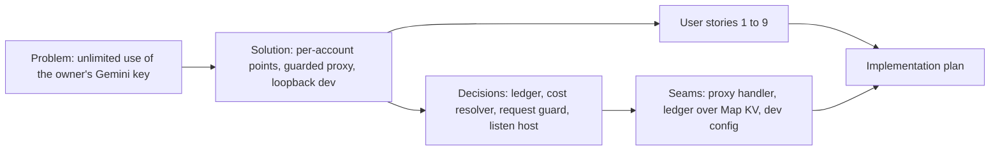

# Spec: adaptiva Gemini proxy and point quota hardening (audit 2026-11-09, wave 1)

- **Status:** Approved (`Section` gate, 2026-11-10)
- **Date:** 2026-11-10
- **Path:** Architectural (changes the stored shape of the point balance in KV and the contract of the production Gemini proxy)
- **Related:** `~/Dokumen/audit-batch-2026-11-09/temuan-adaptiva.json`, `l2-adaptiva.json` (findings `adaptiva-1--logika-1..4`, `adaptiva-1--akses-1..3`, `adaptiva-1--masukan-1`, `adaptiva-1--rantai-pasok-1`), re-verified against commit `78b250c` (unchanged in `origin/main` `7699aa7` for every touched file)

## Problem Statement

Any Google account can sign in to adaptiva and spend the owner's `GEMINI_API_KEY` without a real limit:

1. The 100-point balance lives inside the session, so every new sign-in grants 100 fresh points.
2. The point cost comes from the client header `x-adaptiva-action`; the value `constructor` (or `__proto__`, `toString`) resolves to a function, the balance check compares against `NaN`, and the call is free even at 0 points.
3. The production proxy forwards any path, method, query and header set to Google with the owner's key, including the `adaptiva_sess` cookie, with no body size limit.
4. The deduction is a read-modify-write of the whole session, and `/api/auth/me` rewrites the whole session on every call, so a stale copy can overwrite a deduction and the KV daily write quota drains.
5. The Express dev proxy injects the key with no auth and listens on every interface; the Vite dev server listens on `0.0.0.0`; the locked Vite version has open dev-server advisories.

## Solution

- A signed-in account has one balance of 100 points, granted once per account, which survives sign-out and sign-in.
- An unknown or prototype action name is refused with 400 before any point is touched.
- The proxy only forwards `POST` text generation to `gemini-2.5-flash` (`generateContent`, `streamGenerateContent`), with at most a 1 MB body and a header set it builds itself.
- Reading `/api/auth/me` no longer rewrites the session on every call.
- Local dev servers bind to loopback only, and Vite is on a patched 6.4 release.

## User Stories

1. As the owner, I want each Google account to get 100 points once, so that re-login does not refill the balance.
2. As the owner, I want unknown action names refused, so that no header value makes a call free.
3. As the owner, I want the proxy limited to the one model and two methods the app uses, so that my key cannot reach other Gemini endpoints or models.
4. As the owner, I want the session cookie kept away from Google, so that a third party never sees it.
5. As a learner, I want my balance and the `x-adaptiva-points` header to keep working as before, so that the UI does not change.
6. As a learner whose upstream call fails, I want my points refunded to my account balance, so that a Google error does not cost me.
7. As the owner, I want `/api/auth/me` to stop writing KV on every call, so that the Free plan write quota is not drained.
8. As the owner running `bun run dev`, I want the Express and Vite servers on loopback only, so that nobody on the same LAN can use my key.
9. As the owner, I want Vite on 6.4.6, so that the dev server is not exposed to CVE-2026-112946 and CVE-2026-118662.

## Implementation Decisions

- **Modules:**
  - Point ledger module (new): owns the per-account balance key, the one-time seed, deduction and refund, and rejects a cost or balance that is not a finite number.
  - Session helpers: deduction and refund keep their exported names and return shapes but resolve the session to its `userId` and delegate to the ledger; the session no longer carries the balance; the sliding TTL rewrite happens only when the stored `refreshedAt` is older than 24 hours.
  - Current-user endpoint: reads the balance from the ledger.
  - Gemini proxy: one cost resolver (own-property lookup) used on both the deduction and the refund path; one request guard (method, path, query, body size) evaluated before deduction; upstream headers built from an allowlist; CORS methods limited to `POST, OPTIONS`.
  - Dev servers: Express listen host resolved from `HOST`, defaulting to `127.0.0.1`; Vite `server.host` removed.
- **Schema:** new KV key `points:<userId>` holding a decimal integer. `userId` is the Google `sub`, or the email when `sub` is missing (the existing callback fallback). Sessions written before this change keep a `points` field that is ignored. No migration: every account starts at 100 on first lookup (owner decision).
- **Contracts:** `/api/auth/me` response shape unchanged; `x-adaptiva-points` response header unchanged; new error bodies `400 {error:"unknown_action"}`, `400 {error:"unsupported_request"}`, `413 {error:"payload_too_large"}`.
- **Architecture:** KV per account, small race accepted (owner decision: D1 is full 10/10 on the Free account, a Durable Object needs a separate Worker). Point policy: 100 once per account (owner decision).

## Testing Decisions

- **What a good test is here:** it calls the exported Pages Function handler or ledger function with a fake KV (`Map`) and asserts the response status, the `fetch` call, and the stored balance.

| Seam | What it catches | What it misses |
|---|---|---|
| `onRequest` of the Gemini proxy with a mocked `fetch` and mocked ledger | forbidden method, path, model, query, body size, prototype action names, header leakage | real Google responses (covered by manual smoke after deploy) |
| Ledger functions over a `Map` KV | per-account balance, seed once, NaN rejection, refund | KV eventual consistency across regions (accepted race) |
| `resolveListenHost` and the Vite config object | dev binds | the OS firewall |

- **Prior art:** `functions/api/gemini/__tests__/[[path]].test.ts` (`bun:test`, `mock.module`), `functions/api/auth/__tests__/*.test.ts`.

## Glossary

- **Point ledger:** the per-account balance stored under `points:<userId>`.

## Out of Scope

- Charging by `usageMetadata` instead of the claimed action (a client can still claim the cheaper `tutor` price); backlog.
- Per-IP rate limits, `maxOutputTokens` caps, refund policy for billed upstream failures; backlog.
- Medium and low findings of the 2026-11-09 audit; backlog.
- Production deploy: only on an explicit owner request.

## Further Notes

- Rollback: revert the PR; old sessions still carry `points`, so the previous code keeps working.

## Visual Map

## Approval

| Gate | Answer | Date |
|---|---|---|
| `Cakupan sesi` / `Batas keparahan` / `Bentuk plan` | Wave 1 only; kritis + tinggi; one plan per repo | 2026-11-10 |
| Store / policy / dev proxy / Vite | KV per account; 100 once per account; bind 127.0.0.1; bump to latest 6.4.x | 2026-11-10 |
| `Intent` | Locked | 2026-11-10 |
| `Section adaptiva` | Approved | 2026-11-10 |
| `Spec` | Approved | 2026-11-10 |
