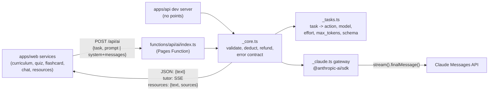

# Design: Adaptiva AI from Gemini to the Claude API

- **Date:** 2026-11-12
- **Status:** Draft, waiting for the `Plan` gate
- **Trigger:** bug "Failed to generate 7-day plan". RCA: `docs/code-plan/debug/2026-11-12-plan-7-hari-json-kutip-rca.md`. In JSON mode without a schema, Gemini emitted bare `"` characters inside string values. The owner then asked for a move to the Claude API.
- **Owner decisions (question tool, 2026-11-12):**
  - Migrate all 9 call sites.
  - Model per action: Sonnet 5.5 for curriculum, module, exam and resources; Haiku 5.5 for quiz, flashcard and tutor.
  - Point costs unchanged.
  - The owner stored the `ANTHROPIC_API_KEY` secret in Pages production.

## 1. Goal and success criteria

Every AI feature in Adaptiva runs on the Claude API through our own Pages Function. Each JSON response is constrained by a server-side schema, so a "Failed to generate..." caused by invalid JSON cannot occur.

- AC-1: the server sends `curriculum.sevenDayPlan` to `claude-sonnet-5-5` with `output_config.effort: "medium"` and `output_config.format` = a JSON schema with seven required properties `day1` to `day7`.
- AC-2: every JSON task (7) sends a JSON schema, with the model and effort from the mapping table. The client cannot pick the model, effort, `max_tokens` or schema.
- AC-3: the points contract is preserved:
  - deduct before the call;
  - refund once on API error or network failure;
  - the `x-adaptiva-points` header;
  - the error strings the client matches on: `unauthorized`, `insufficient_points`, `ai_generation_failed`, `ai_generation_blocked`, `ai_upstream_network_error`.
- AC-4: the tutor chat streams over SSE from Haiku 5.5. The conversation history is sent by the client, because the server is stateless.
- AC-5: resources use the Sonnet 5.5 `web_search` tool and return `{text, sources[{uri,title}]}` taken from the `web_search_tool_result` blocks.
- AC-6: the exported web service functions (`generate*`, `fetchLearningResources`, `startChatSession`, `sendMessageToTutorStream`) keep their names and parameters. Callers in `App.tsx` and the hooks do not change behaviour.
- AC-7: `@google/genai`, `functions/api/gemini`, the `/api/gemini` dev proxy and the `/api/gemini` redirect are gone. `bun run test`, `bun run test:functions`, `bun test apps/api`, the web `tsc` and `bun run build` all exit 0.

## 2. Architecture

### 2.1 Task registry (`functions/api/ai/_tasks.ts`)

| Task id | Action (points) | Model | Effort | max_tokens | Output |
|---|---|---|---|---|---|
| `curriculum.outline` | curriculum (20) | claude-sonnet-5-5 | medium | 16384 | schema `{syllabus, moduleTitles[]}` |
| `curriculum.sevenDayPlan` | curriculum (20) | claude-sonnet-5-5 | medium | 16384 | schema `{day1..day7: {task, summaryFocus}}` |
| `module.summary` | module (5) | claude-sonnet-5-5 | medium | 32768 | schema `{moduleMaterial}` |
| `exam.questions` | exam (15) | claude-sonnet-5-5 | medium | 32768 | schema `{questions[{questionText, options[], correctAnswer, explanation}]}` |
| `resources.search` | default (5) | claude-sonnet-5-5 | medium | 16384 | markdown text + `web_search_20250305` (`max_uses: 3`) |
| `quiz.questions` | quiz (10) | claude-haiku-5-5 | medium | 16384 | schema `{questions[{question, options[], correctAnswer, explanation}]}` |
| `quiz.explanation` | quiz (10) | claude-haiku-5-5 | medium | 16384 | schema `{detailedExplanation}` |
| `flashcard.cards` | flashcard (5) | claude-haiku-5-5 | low | 16384 | schema `{flashcards[{term, definition}]}` |
| `tutor.chat` | tutor (2) | claude-haiku-5-5 | low | 8192 | SSE text |

- `ACTION_POINT_COSTS` and the caps move here, with the same values. `pointCosts.test.ts` follows the new import path.
- Every schema: object root, `additionalProperties: false`, all properties `required`.
- No `minItems > 1` and no `maxItems`. The structured-outputs docs (fetched 2026-11-12) say these are unsupported and return a 400.
- The `day1..day7` form guarantees exactly 7 days. On the client, `generateSevenDayPlan` maps it back to `days[]` with `day = 1..7`.

### 2.2 Gateway (`functions/api/ai/_claude.ts`)

- `createClaudeGateway(apiKey, fetchImpl?)` returns `{ complete(spec, input), streamText(spec, input, onDelta) }`.
- It is the only module that imports `@anthropic-ai/sdk`. It is the system boundary that the core tests replace.
- Every call goes through `stream(...)` and `finalMessage()`. The skill docs recommend streaming above about 16K `max_tokens`, and module and exam reach 32768.
- Sonnet: `client.beta.messages.stream({ betas: ["server-side-fallback-2026-07-01"], fallbacks: "default", ... })`.
- Haiku: `client.messages.stream(...)` without `fallbacks`. The docs say Haiku 5.5 has no server fallback and a list form returns a 400.
- No `temperature`, `top_p` or `thinking: disabled`. Those are 400s on these models.
- The result text comes from the `type === "text"` block. `thinking` blocks may come first.
- SDK retries (`maxRetries` 2: 429, 5xx, 529, connection) replace the old `executeWithRetries`.

### 2.3 Core (`functions/api/ai/_core.ts`)

`handleAiRequest(request, env, deps)` with `deps = { gateway, deduct, refund }`. The dev server passes `deduct` and `refund` as no-ops.

| Condition | Status, body `error` | Points |
|---|---|---|
| Method other than POST | 405 `method_not_allowed` | no deduct |
| Body > 1 MiB | 413 `payload_too_large` | no deduct |
| Body not JSON, task unknown, `prompt` empty, invalid `messages` (tutor) | 400 `unsupported_request` / `unknown_task` | no deduct |
| No session | 401 `unauthorized` | none |
| Insufficient points | 429 `insufficient_points` | none |
| SDK `APIError` (after its own retries) | 400 `ai_generation_failed` | refund once |
| Connection or timeout | 400 `ai_upstream_network_error` | refund once |
| `stop_reason: "refusal"` | 400 `ai_generation_blocked` | not refunded (same as the old proxy's blocked handling); message names the category |
| `stop_reason: "max_tokens"` | 200 with the text as is | billed, same as MAX_TOKENS before |
| Success | 200 JSON `{text}` or `{text, sources}`, header `x-adaptiva-points` | |
| Exception after deduct | 502 `Proxy error` | refund once |

Messages and refund notes ("Poin Anda telah dikembalikan." / "Poin Anda gagal dikembalikan, silakan hubungi admin.") are copied from the old proxy.

### 2.4 Tutor SSE and resources

- `tutor.chat`:
  - Body: `{task, system, messages: [{role: "user"|"assistant", content}]}`. Last turn is `user`, at most 40 turns, each content ≤ 8,000 characters.
  - Response is `text/event-stream` with frames `data: {"type":"delta","text":...}`, ending with `{"type":"done"}` or `{"type":"error","error":...,"message":...}`.
  - An error before the first delta gets a refund. After partial output there is none, because the tokens were billed.
- `resources.search`:
  - The text is the final text block (citations ignored).
  - `sources` = the unique `url`/`title` pairs from `web_search_tool_result`, mapped to `{web:{uri,title}}` on the client so `LearningResource` stays the same.
  - `pause_turn`: send the assistant content back unchanged, at most 2 times.
  - A search error inside the 200 response is not an exception: the text is returned with `sources: []`.

### 2.5 Web client

- `core.ts`:
  - `getAiClient` and `ai` are replaced by `callAiTask(task, body)`. It does `fetch('/api/ai')` with credentials, and throws `Error("<status> <error>: <message>")` for non-2xx, so `callWithRetries` keeps working.
  - `rg x-adaptiva-points apps/web/src` returns nothing: the client never reads that header. The server keeps sending it, and the client needs no change for it.
- `parseGeminiJsonResponse` and `cleanAiOutput` stay as they are (renaming is deferred).
- `chat.ts`:
  - `Chat` from `@google/genai` is replaced by `TutorChat { system: string; history: {role, content}[] }` in `types.ts`.
  - `startChatSession` is still synchronous.
  - `sendMessageToTutorStream` reads the SSE stream and appends turns to `history` after `done`.
  - The per-chunk `cleanAiOutput` behaviour (trim) is kept.
- Prompts change only where the shape changes:
  - the 7-day plan (`day1..day7`);
  - the quiz (wrapped as `{questions}`);
  - the exam (drop the `type` and `maxPoints` fields, because the client ignores them);
  - resources (remove the sentence about Google Search).
- `@google/genai` is removed from `apps/web/package.json` and from the `index.html` importmap.

### 2.6 Dev server

- `apps/api` gets a POST `/api/ai` route that converts the Express request to a `Request`, calls `handleAiRequest` with no-op points, and reads the key `ANTHROPIC_API_KEY` from `.env.local`.
- The `/api/gemini` route and `requireGeminiKey` are removed.
- Vite proxies `/api/ai` to `127.0.0.1:3001`.
- The loopback bind guard stays.

## 3. Alternatives considered

| Option | Verdict |
|---|---|
| Keep Gemini and add `responseJsonSchema` | Rejected by the owner (migrate everything) |
| Repair quotes in the parser | Heuristic, can mis-repair. Not needed once there is a schema. |
| Client sends model and schema | Rejected: a cheap action could buy Sonnet. The server decides. |
| `web_search` + `output_config.format` in one call | Docs (2026-11-12): citations together with `format` return a 400, and web search always cites. Markdown text plus sources from the result blocks instead. |
| `web_search_20260209` | Its default runs through code execution. `20250305` is documented for Sonnet 5.5 and enough for 3 searches. |

## 4. Non-goals

- Changing point prices. Deploying to production (asked separately after the PR). Removing the `GEMINI_API_KEY` secret (owner, after production is verified).
- Renaming `services/gemini/` and `parseGeminiJsonResponse`. `defer: names stay "gemini" while behaviour is Claude, upgrade-trigger: the next PR that touches services/ in bulk.`
- Fixing the per-chunk trim in the tutor (old behaviour, recorded as debt).

## 5. Risks and rollback

- **Cost:** Sonnet at $2/$10 per MTok and web search at $10 per 1,000 searches, while points stay the same. Mitigations: `max_uses: 3` and the caps per task. A usage log per action is a follow-up.
- **Refusals:** with `fallbacks: "default"`, Sonnet only retries the `cyber` and `frontier_llm` categories (`model-migration.md`). Other refusals become `ai_generation_blocked`.
- **SDK bundle on Workers:** `@anthropic-ai/sdk` 1.3.0 lists Cloudflare Workers support (README, fetched 2026-11-12). The real size is measured by `bun run build` plus `wrangler pages functions build` in T10.
- **Rollback:** `git revert` the merge commit. The `GEMINI_API_KEY` secret is still there, so the old version runs again without any configuration.

## 6. Sources

- Claude API skill (local, version 2.1.322): `shared/tool-use-concepts.md` (structured outputs, supported models), `shared/model-migration.md` (Sonnet 5.5, Haiku 5.5), `typescript/claude-api/{README,streaming}.md`.
- https://platform.claude.com/docs/en/build-with-claude/structured-outputs.md (fetched 2026-11-12): schema limits, `minItems` 0/1 only, citations together with `format` return a 400.
- https://platform.claude.com/docs/en/agents-and-tools/tool-use/web-search-tool.md (fetched 2026-11-12): tool types, result blocks, $10 per 1,000 searches.
- https://platform.claude.com/docs/en/build-with-claude/refusals-and-fallback.md (fetched 2026-11-12): refusal billing.
- https://registry.npmjs.org/@anthropic-ai/sdk/latest (fetched 2026-11-12): version 1.3.0.
- Research reports R1 to R3 and C1 to C3 for this session (proxy contract `functions/api/gemini/[[path]].ts`, call sites, history).
